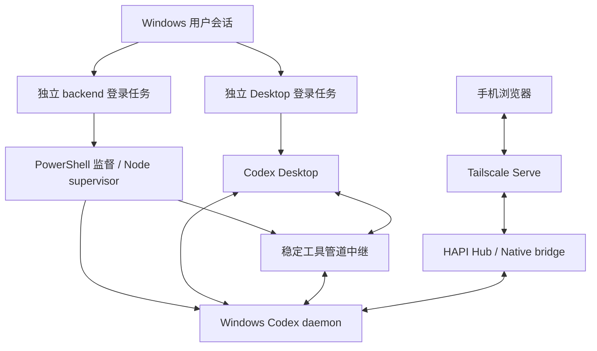

# Windows Desktop 与 HAPI 共用 Codex backend

当前方案让 Desktop 和 HAPI 连接同一个 Windows Codex daemon。HAPI Native 是 RPC bridge、列表过滤及有界缓存；对话历史和执行状态由 Codex 持有。

Desktop 退出后 backend 可继续工作。任务通过系统 `wscript.exe` 与小型 JScript 引导隐藏启动 PowerShell；daemon 的生命周期不再靠 Desktop 窗口维持。正常重启后恢复用户会话可选 ARSO，具体条件见 [Windows 服务](WINDOWS_SERVICES.md)。

## 接线方式

`resolve-runtime.ps1` 从目标机器的 Desktop 安装和 CLI runtime 中解析实际路径。`install.ps1` 生成私有配置，保存之前的用户级 endpoint，创建停用的 backend/Desktop 任务。它不会在 staging 阶段改变正常 Desktop 的 endpoint。`switch.ps1` 启动并验证两条通路后才写用户级 `CODEX_APP_SERVER_WS_URL`。

supervisor 持有稳定工具管道，连接 daemon 所需的 Desktop 工具能力。Desktop task 等待同一个 backend，并按配置连接中继。实际 Node、Desktop、Codex home 和 endpoint 写在目标机配置中，不随分发包提供。

这里复用了 Desktop 的连接覆盖入口和工具通路，属于需要随 Desktop 升级核对的适配；HAPI 原生操作继续调用 daemon RPC。安装时的检查和升级后的 readiness 用于确认当前版本的接线，不把某个历史版本的内部结构当成永久接口。

## 身份、停止与恢复

只看到端口或旧 `managed.json` 的 ready 不够。当前检查保持真实 WebSocket initialize 连接，核对平台、Codex home、进程身份和 TCP 端点关联，Desktop backend 与工具连接另行核对。Windows TCP 状态枚举异常时仍通过活连接与进程关联验证，不能直接跳过身份检查。

监督脚本使用独占文件锁，并跟踪启动者的进程代际。停止请求由当前实例消费，退出清理状态，启动失败使用失败退出码。更新流程从独立进程执行，失败后恢复之前入口、任务和运行状态。旧的永久 `state/stop`、同一任务顺便打开 Desktop、手工复制旧 checkout 的操作均不作为当前部署步骤。

## HAPI 与其他主机

Windows 和 WSL daemon 是不同主机，各自持有自己的会话；在 HAPI 配置中为它们使用不同的目标机标识与连接方式。Desktop 平台和 daemon 平台可以不同。Desktop 的工作区关联只作为能识别时的补充；daemon 项目与事件优先，无关联时提供未分组候选，由用户选择到 HAPI 列表。

文件读取、附件与媒体由相应主机的现有文件链路处理；媒体使用 HTTP 缓存与 Range，见 [媒体缓存与预览](MEDIA_CACHE_PREVIEW.md)。工作区外访问由服务端 `fileAccess` 决定。协议能力和功能边界见 [daemon 接口覆盖](docs/codex-native-daemon-coverage.md)。

安装、切换与回退步骤见 [迁移指南](WINDOWS_DESKTOP_MIGRATION.md)；各参考源文件的 commit/hash 见 `WINDOWS_REFERENCE_MANIFEST.json`。
